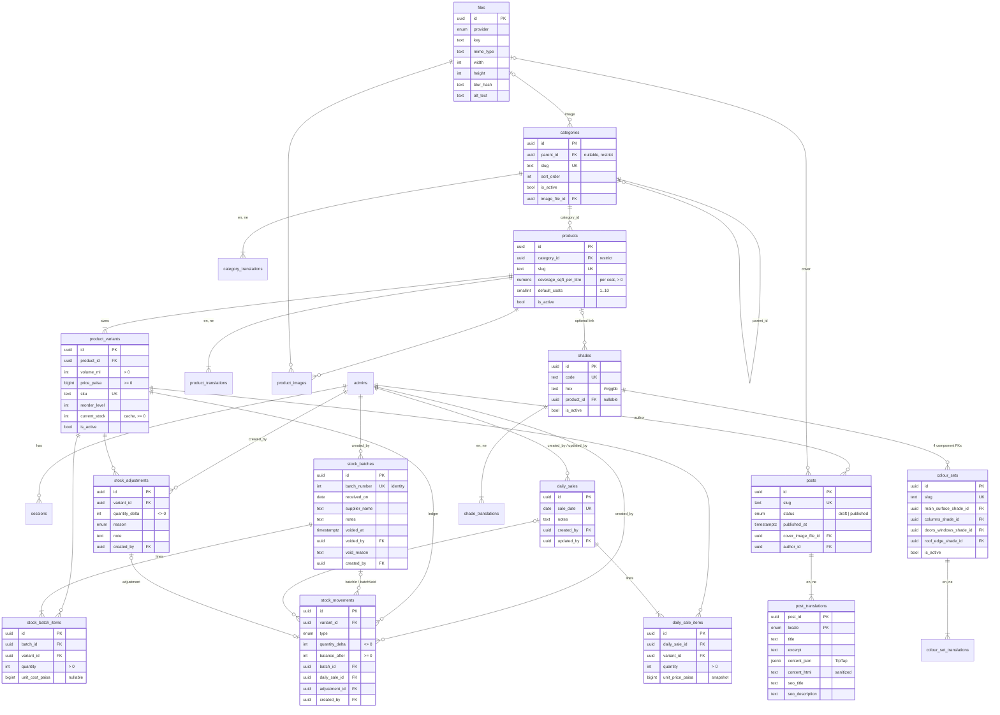

# Database schema

Source of truth: `packages/database/src/schema/*.schema.ts`. Migrations: `packages/database/drizzle/`. This page explains the shape and the rules the schema enforces; regenerate the diagram by hand when tables change.

## Conventions in every table

- `id uuid` primary key, `uuid_generate_v7()` (time-ordered).
- `created_at` / `updated_at` `timestamptz`. History tables (`stock_movements`, `stock_adjustments`, `files`, `slug_redirects`) have only `created_at`; they are never edited.
- **No soft delete.** Rows retire through domain state: `is_active`, `voided_at`, `status`.
- Money: integer **paisa** in `bigint` columns named `*_paisa`. Volume: integer **millilitres** (`volume_ml`).
- Translatable text lives in `*_translations` tables keyed `(entity_id, locale)`, with `locale ∈ {en, ne}`. English is required by the API; Nepali is optional and falls back to English. Slugs are not translated.
- Enum values come from `@repo/shared` (one source of truth).

## Diagram

Not drawn: `category_translations` and `product_translations` share the shape `(entity_id, locale) PK, name, description?, seo_title?, seo_description?`; `shade_translations` has only `name`, and `colour_set_translations` has `name, description?`. Also not drawn: `slug_redirects (entity_type, old_slug) UK → entity_id`, `store_settings` (single row: store details, `default_wastage_bps`), `admins`, and `sessions`.

## Rules the database enforces

| Rule | How |
|---|---|
| Stock never goes negative | `CHECK current_stock >= 0` on variants and `balance_after >= 0` on movements, so an oversell fails inside the transaction even if service code misses it |
| One price per size | `UNIQUE (product_id, volume_ml)` |
| A movement points at exactly the source its type implies | `CHECK` on `stock_movements`: `batchIn`/`batchVoid` → `batch_id`; `sale`/`saleEdit` → `daily_sale_id`; `adjustment` → `adjustment_id`; signs fixed for `batchIn` (+), `batchVoid` (−), `sale` (−) |
| One daily sales entry per date | `UNIQUE (sale_date)` |
| A void records who voided it | `CHECK (voided_at IS NULL) = (voided_by IS NULL)` |
| A category can't be deleted while it has children or products | `ON DELETE RESTRICT` on `categories.parent_id` and `products.category_id` (the API deactivates instead) |
| A category isn't its own parent | `CHECK parent_id IS DISTINCT FROM id` (deeper cycles are checked in the service, which walks the tree before a move) |
| Ledger rows are permanent | Every FK into variants, batches, sales and admins from history tables is `RESTRICT` |
| Exactly one shade per visualizer component | Four `NOT NULL` FK columns on `colour_sets` |
| Hex colours are normalised | `CHECK hex ~ '^#[0-9a-f]{6}$'` |
| Published posts have a date | `CHECK status <> 'published' OR published_at IS NOT NULL` |
| One settings row | `CHECK id = 1` |

## How the stock ledger is written (Phase 3 services)

Every stock-changing operation runs in one transaction:

1. `SELECT ... FROM product_variants WHERE id IN (...) ORDER BY id FOR UPDATE`. Locking in id order means two concurrent operations can't deadlock.
2. Validate: no resulting stock below zero. Return a clear 409 listing the short variants.
3. Write the domain row(s) (batch and items, sale and items, or adjustment).
4. For each variant: `UPDATE product_variants SET current_stock = current_stock + Δ RETURNING current_stock`, then `INSERT stock_movements (Δ, balance_after = returned stock, source ref)`.

| Operation | Movements |
|---|---|
| Record batch | `batchIn +qty` per item |
| Void batch | `batchVoid −qty` per item; fails if the stock has since been sold below that |
| Record day's sales | `sale −qty` per line |
| Edit day's sales | `saleEdit` with the per-variant difference (old vs new quantity); no movement when unchanged |
| Adjustment | `adjustment ±qty` |

Invariant (checked by tests): for every variant, `current_stock = SUM(stock_movements.quantity_delta)`.

## Indexes for analytics

- `stock_movements (variant_id, created_at DESC)`: per-variant history chart.
- `stock_movements (type, created_at DESC)`: sales/stock-in over time.
- `daily_sales (sale_date)` unique, `daily_sale_items (variant_id)`: sales over time, top sellers, slow movers.
- `product_variants` partial index `WHERE is_active AND current_stock <= reorder_level`: the low-stock list.
- `stock_batches (received_on DESC)`, `posts (published_at DESC) WHERE published`.

## Seed data

- `pnpm db:seed`: the admin from `SUPER_ADMIN_*` and the store settings row (10% default wastage). Idempotent; safe in every environment.
- `pnpm db:seed:sample`: **sample data** (refuses in production, skips if the catalogue isn't empty). It loads:
  - the Primer tree (Exterior → Damp-proof / Normal, Interior), Interior Colour (Apex Royal / Premium Emulsion / Tractor Emulsion), Exterior Colour and Enamel;
  - 8 products with 30 variants, including a 0.5L enamel and a damp-proof primer with **no 1L size** (for the calculator's least-overshoot path);
  - 2 batches, 3 days of sales and 1 adjustment, all written through the ledger;
  - 7 shades and 2 colour sets;
  - some Nepali translations, to exercise the fallback.

  Every record says "Sample data" in its notes or description, and every SKU starts with `SMP-`. Tractor Emulsion 1L ends below its reorder level, so the low-stock alert has something to show.
